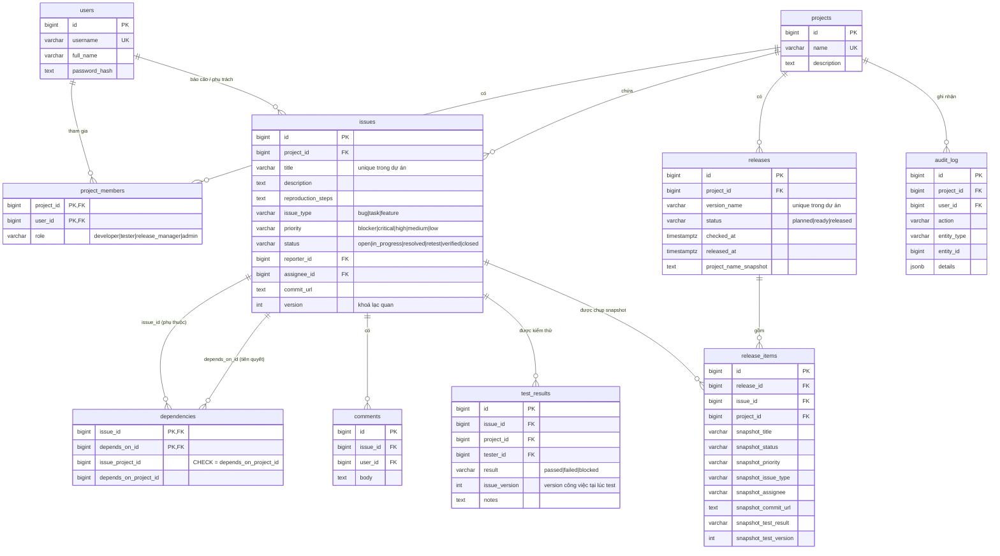
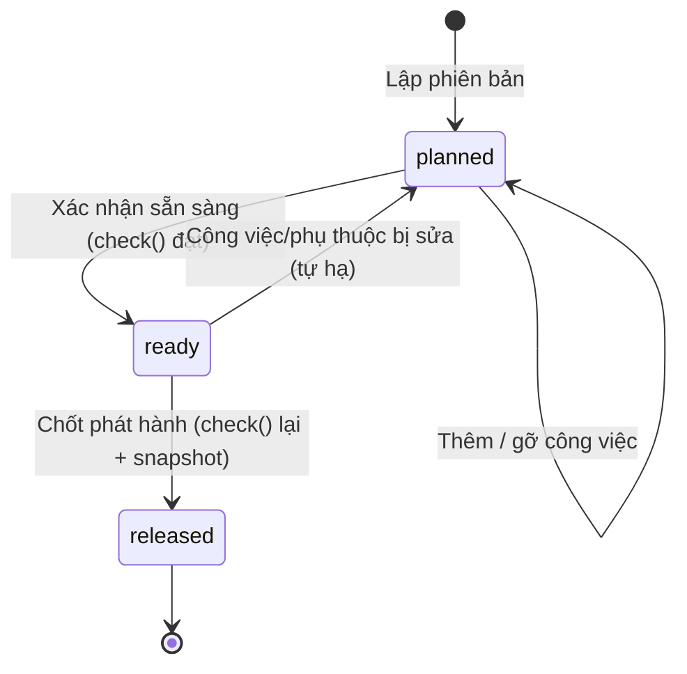
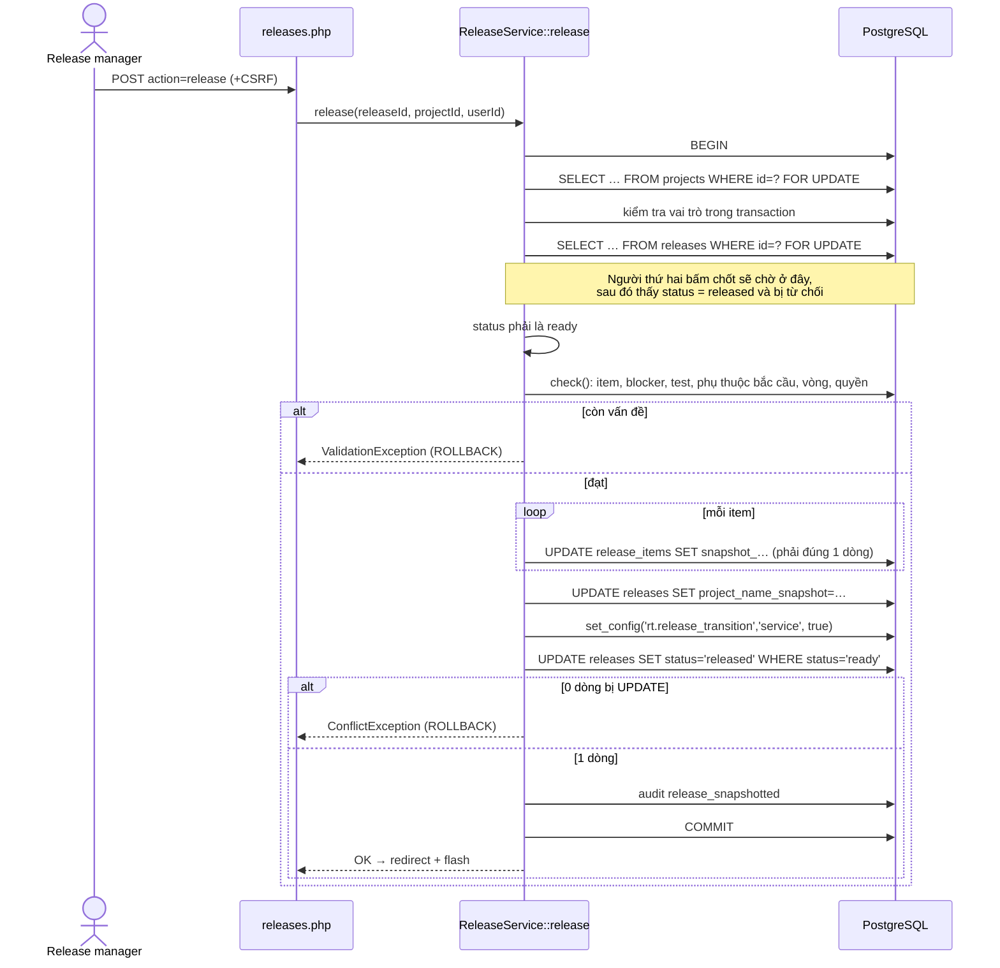

# Kiến trúc ReleaseTracker

Tài liệu dành cho người đọc mã: cách tổ chức, sơ đồ bảng, luồng chốt phát hành và hai cơ chế cốt lõi — khoá lạc quan (optimistic locking) và snapshot.

## 1. Tổ chức mã

```text
Trình duyệt ──HTTP──► public/*.php  (controller + view)
                         │  requireLogin, checkCsrf, selectProject, render bằng h()
                         ▼
                      src/*Service.php  (nghiệp vụ, mỗi thao tác ghi = 1 transaction)
                         │  queryParams (pg_query_params), audit()
                         ▼
                      PostgreSQL  (ràng buộc, khoá ngoại tổ hợp, trigger bảo vệ)
```

| Thành phần | Trách nhiệm |
| --- | --- |
| `src/App.php` | Session, CSRF, kiểm tra quyền theo dự án, `audit()`, `selectProject()`, layout (`pageStart/pageEnd`), hằng enum |
| `src/Database.php` | Kết nối, `queryParams`, `transaction()` (tự dùng SAVEPOINT khi đã ở trong transaction), `projectLock()` |
| `src/IssueService.php` | Tạo/sửa công việc có version, bình luận, ghi kết quả kiểm thử, đổi ưu tiên, lịch sử, tra ngược phiên bản |
| `src/DependencyService.php` | Đồ thị phụ thuộc: DFS tìm đường/vòng (hàm thuần), thêm/gỡ quan hệ, danh sách việc bị chặn, hạ phiên bản ready |
| `src/ReleaseService.php` | Điều kiện phát hành (`conditions`, `check`), tạo phiên bản, thêm/gỡ item, `markReady`, `release` (chốt + snapshot) |
| `src/ReleaseNotes.php` | Dựng ghi chú Markdown/TXT chỉ từ snapshot, xuất file có kiểm tra quyền |
| `src/Labels.php`, `src/History.php` | Hàm thuần: nhãn tiếng Việt, badge, mô tả lịch sử từ audit |
| `database/migrations/` | 001–007, mỗi file chạy lại được (`IF NOT EXISTS`, kiểm tra constraint trước khi thêm) |

Mọi thao tác ghi đi theo cùng một khuôn: controller kiểm tra CSRF và đăng nhập → service mở transaction → khoá dự án (`SELECT … FROM projects … FOR UPDATE`) → kiểm tra lại quyền **trong** transaction (chống TOCTOU khi vai trò bị đổi giữa chừng) → đọc bản ghi cần sửa bằng `FOR UPDATE` → kiểm tra nghiệp vụ → ghi dữ liệu + audit → commit. Thành công thì controller redirect (Post/Redirect/Get) kèm flash message.

## 2. Sơ đồ bảng



Ràng buộc đáng chú ý:

- Khoá ngoại tổ hợp `(issue_id, project_id) → issues(id, project_id)` trên `test_results`, `dependencies`, `release_items`: CSDL tự từ chối dữ liệu chéo dự án.
- `dependencies`: `CHECK (issue_id <> depends_on_id)` và `CHECK (issue_project_id = depends_on_project_id)`. Kiểm tra vòng làm ở PHP (DFS) vì cần trả về chuỗi gây vòng.
- Trigger: `audit_log` chỉ ghi thêm; `releases` ở `released` không sửa/xoá được; `release_items` chỉ thêm/xoá khi phiên bản `planned`, không sửa khi đã `released`; đổi `releases.status` chỉ được khi service bật cờ `rt.release_transition` trong transaction.

## 3. Kiểm tra vòng phụ thuộc

Cạnh `A → B` nghĩa là "A phụ thuộc B". Thêm cạnh `X → Y` tạo vòng khi và chỉ khi từ `Y` đã đi tới được `X`. `DependencyService::cycleIfAdded()` chạy DFS (ngăn xếp tường minh, đánh dấu đỉnh đã thăm, O(V+E)) từ `Y`; nếu tìm thấy đường `Y … X` thì chuỗi vòng là `Y … X → Y`. Ví dụ đã có A→B, B→C, thêm C→A: từ A tới được C qua B, nên thông báo là `#A → #B → #C → #A`.

Để hai request không cùng lúc mỗi bên thêm "một nửa" vòng, `add()` giữ `pg_advisory_xact_lock(project_id)` rồi mới đọc đồ thị và kiểm tra.

## 4. Luồng chốt phát hành





Khi một công việc, kết quả kiểm thử hoặc phụ thuộc thay đổi, `DependencyService::invalidateReadyReleases()` tìm (bằng CTE đệ quy) mọi phiên bản `ready` chứa công việc đó hoặc công việc phụ thuộc vào nó, và hạ về `planned` trong cùng transaction.

### Quy tắc blocker (điều kiện 4)

Một item bị coi là blocker nếu ưu tiên hiện tại là `blocker`, **hoặc** `snapshot_priority` lúc gắn vào phiên bản là `blocker`, **hoặc** audit có bản ghi `priority_changed` từ/thành `blocker` sau bản ghi `release_item_added` của item. Blocker đạt khi: trạng thái verified/closed, kết quả kiểm thử mới nhất là passed, `test_results.issue_version = issues.version` và bản ghi audit `test_result_recorded` khớp người ghi, kết quả, version và vai trò hợp lệ lúc ghi.

## 5. Khoá lạc quan (optimistic locking)

Bài toán: hai người mở cùng một công việc, cả hai sửa rồi lưu. Không khoá thì người lưu sau âm thầm ghi đè người lưu trước.

Cơ chế: mỗi công việc có cột `version`. Form sửa gửi kèm version người dùng nhìn thấy. Câu lệnh ghi là:

```sql
UPDATE issues SET …, version = version + 1
WHERE id = $id AND project_id = $project AND version = $version_da_thay
RETURNING version;
```

- Nếu version trong CSDL đã khác (người khác vừa lưu) thì 0 dòng bị cập nhật → `VersionConflictException`. Không có gì bị ghi đè.
- Exception mang theo bản hiện tại trong CSDL; giao diện hiển thị hai bản cạnh nhau, cho chọn **Tải bản mới nhất** hoặc **Ghi đè có chủ đích** (gửi lại bản của mình với version mới; audit ghi `overwrite_after_conflict: true`). Nếu lại có người lưu chen vào, hệ thống báo xung đột lần nữa.
- "Lạc quan" vì không giữ khoá trong lúc người dùng đang gõ; chỉ kiểm tra lúc lưu. Trong lúc lưu, service vẫn khoá dòng `FOR UPDATE` để các bước kiểm tra và ghi là nguyên tử.
- Ghi kết quả kiểm thử cũng dùng version: kết quả gắn với `issue_version`; sửa công việc sau đó làm tăng version nên kết quả passed cũ tự trở thành "lỗi thời" và không còn được tính cho điều kiện phát hành.

## 6. Snapshot

Bài toán: sau khi phát hành, công việc vẫn tiếp tục được sửa (đổi tiêu đề, mở lại…), nhưng danh sách "đã phát hành trong bản 1.2.0" và ghi chú phát hành phải giữ nguyên như lúc chốt.

Cơ chế:

- Lúc chốt, trong cùng transaction với `check()`, service chép các trường cần thiết của từng công việc vào `release_items.snapshot_*` (tiêu đề, trạng thái, ưu tiên, loại, người phụ trách, mô tả, link commit/PR, kết quả kiểm thử đã được xác minh nguồn gốc và version của lần test), và chép tên dự án vào `releases.project_name_snapshot`.
- Ghi chú phát hành (`ReleaseNotes`) và trang phiên bản đã chốt **chỉ đọc snapshot**, không join sang `issues` hay `projects`.
- Trigger CSDL chặn mọi `UPDATE/DELETE` trên `release_items` của phiên bản `released`, chặn `INSERT` khi phiên bản không còn `planned`, và chặn sửa chính dòng `releases` đã `released` — kể cả khi ai đó chạy SQL trực tiếp.
- Kết quả kiểm thử không có bằng chứng nguồn gốc hợp lệ được chụp thành `unverified`, không bao giờ hiển thị như `passed`.
- Tra ngược "công việc này từng nằm trong những bản phát hành nào" đọc từ `release_items` của các phiên bản `released`.
